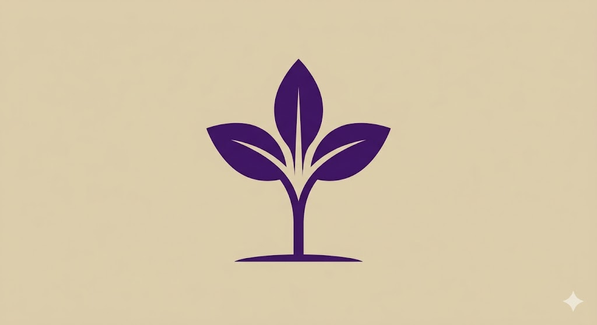

# Educarama ⚜️

> **Educación + Rama**: Una herramienta digital para el seguimiento del crecimiento y la progresión personal en el Movimiento Scout.



## 📖 Sobre el Proyecto
Educarama nace como un proyecto universitario para la carrera de **Desarrollo de Software**. Su objetivo es solucionar la fragmentación de la información en los grupos scouts, donde actualmente se depende de métodos manuales o planillas de Excel genéricas que dificultan el seguimiento pedagógico.

A diferencia de los sistemas oficiales centrados en lo administrativo, Educarama es una herramienta diseñada para el **trabajo de campo del educador**, enfocándose en la visualización clara y rápida del progreso de cada joven

---

## 🚀 Funcionalidades Core (MVP 1)
En esta primera etapa, el sistema se centra en los requerimientos operativos clave para garantizar una gestión de punta a punta:

* **Gestión de Educadores:** Registro de perfiles con asignación de ramas y permisos según el rol.
* **Gestión de Scouts:** Alta de beneficiarios con datos personales (DNI, edad) y gestión de archivos/documentación adjunta.
* **Progresión Básica:** Módulo para la asignación directa de competencias y automatización de la entrega de insignias.
* **Gestión de Proyectos Scout:** Panel de control para identificar la etapa actual del ciclo de proyecto de cada grupo.

---

## 🛠️ Stack Tecnológico
* **Backend:** PHP (API y lógica de servidor).
* **Base de Datos:** MySQL.
* **Frontend:** HTML5, CSS3, JavaScript.
* **Framework CSS:** Bootstrap 5.
* **Entorno de Desarrollo:** XAMPP (Localhost).

### Estructura de Directorios
```text
/api        # Endpoints y lógica de negocio
/config     # Configuración de base de datos y constantes
/includes   # Componentes reutilizables (header, footer, funciones)
/pages      # Vistas principales de la aplicación
/public     # Recursos estáticos (imágenes, CSS, JS)
database.sql # Script para la creación de la base de datos
