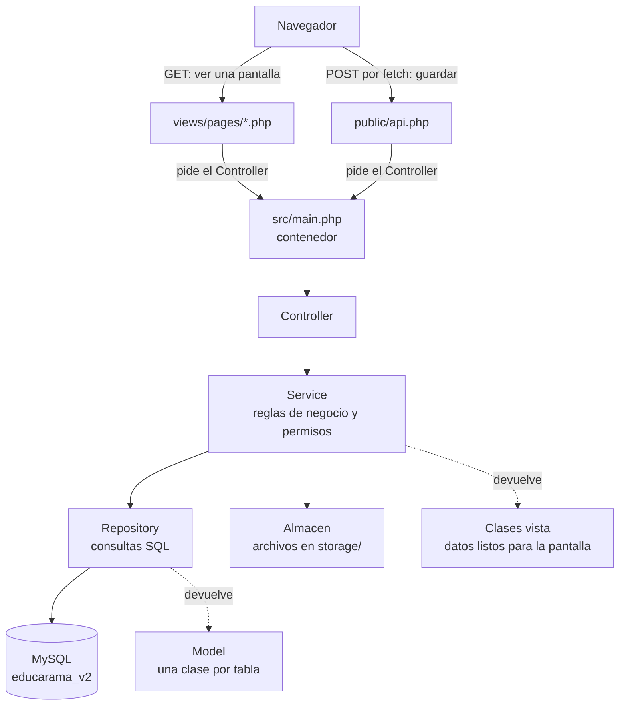
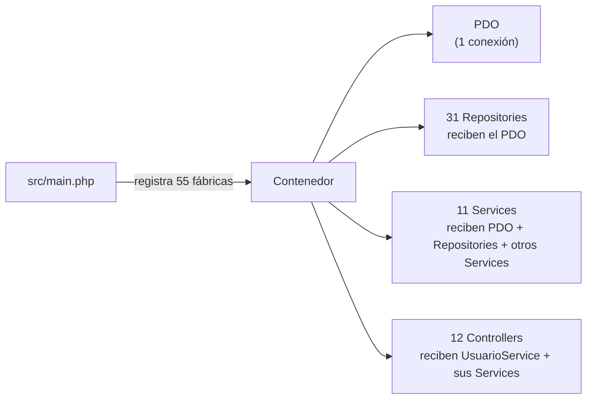
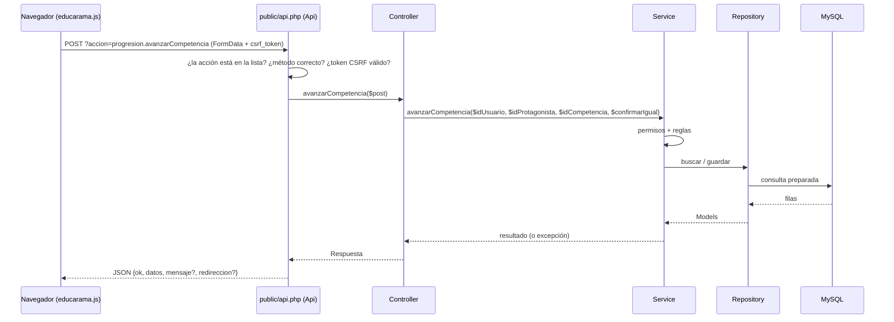
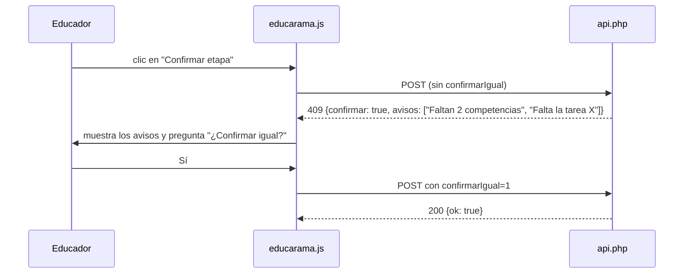
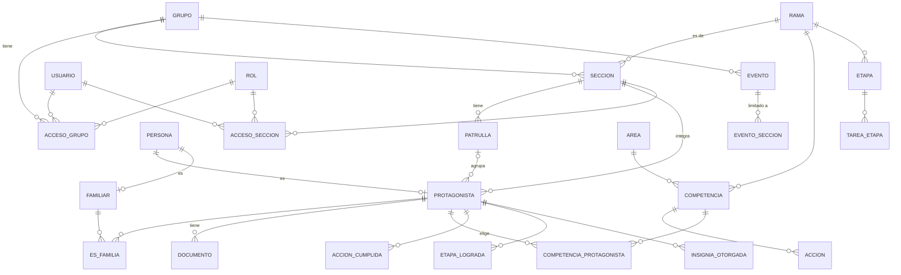
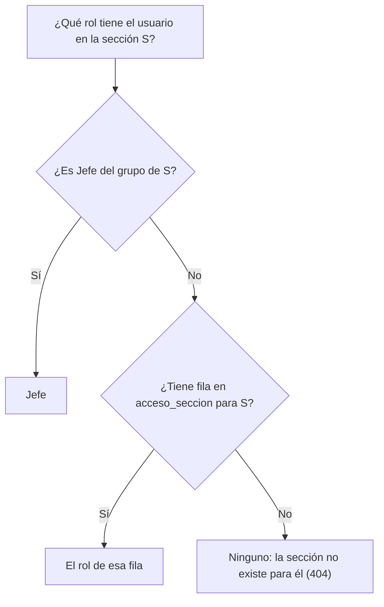

# Educarama — Descripción técnica

**Versión 2.1** (rama `refactor/v2.1`). Respecto de la v2, la novedad es la **inyección de dependencias centralizada**: un contenedor propio (`src/Contenedor.php`) y un único lugar donde se arman todos los objetos (`src/main.php`). Ver la sección 5.1.

Este documento describe **cómo está hecho** Educarama: tecnologías, carpetas, capas, flujo de un pedido, base de datos, roles y módulos. Las razones de cada decisión están en [fundamentos-y-decisiones.md](fundamentos-y-decisiones.md). El historial detallado de cada cambio está en [explicacion-de-cambios.md](explicacion-de-cambios.md).

Cada sección termina con un recuadro **"En pocas palabras"** con lo esencial.

---

## 1. Qué es Educarama

Educarama (**Educa**ción + **Rama**) es una aplicación web para que los educadores de Scouts de Argentina sigan la **progresión personal** de los protagonistas, es decir, los chicos y jóvenes del grupo: qué competencias eligieron, cuáles desarrollaron, en qué etapa están y qué insignias recibieron. Además guarda los datos de cada protagonista, sus familiares, sus documentos y los eventos del grupo.

Es un proyecto universitario en equipo (Desarrollo de Software, Instituto Leopoldo Marechal). La versión actual se desarrolla en la rama `refactor/v2`, que rehízo todo el proyecto. El código anterior quedó en `_legacy/` solo como consulta.

**Conceptos del dominio que aparecen en todo el documento:**

| Término | Qué es |
|---|---|
| **Rama** | Categoría del programa scout según la edad. Hay 4 fijas: Lobatos y Lobeznas, Scouts, Caminantes y Rovers. |
| **Grupo** | Un grupo scout concreto (ej. "Grupo 901 Los Aromos"). |
| **Sección** | La rama dentro de un grupo concreto (ej. "Manada Luna Llena del grupo 901"). Un grupo tiene varias secciones. |
| **Patrulla** | Pequeño equipo dentro de una sección (no existe en Rovers). |
| **Protagonista** | El chico o joven que hace la progresión. No es usuario del sistema. |
| **Educador / usuario** | El adulto que usa la aplicación, con un rol en un grupo o sección. |
| **Área** | Dimensión del desarrollo (Salud y Bienestar, Ambiente, etc.). |
| **Competencia** | Lo que el protagonista desarrolla dentro de un área. |
| **Acción** | Actividad concreta que demuestra una competencia (LyL, Scouts y Caminantes). |
| **Etapa** | Tramo de la progresión de una rama (ej. Pistas, Senda, Rumbo y Travesía en Scouts). |
| **Insignia** | Distintivo físico que se entrega al protagonista. |

> **En pocas palabras:** Educarama registra la progresión personal de los protagonistas scouts, organizada por grupo, sección y rama, y la deja en manos de sus educadores.

---

## 2. Stack tecnológico

| Capa | Tecnología |
|---|---|
| Servidor | PHP 8.1+ orientado a objetos, con `declare(strict_types=1)` en cada archivo |
| Base de datos | MySQL / MariaDB, acceso por PDO (consultas preparadas, sin emulación) |
| Front-end | HTML5, CSS3 y JavaScript sin frameworks (`fetch`) |
| Estilos | Bootstrap 5.3.3 y Bootstrap Icons 1.10.5, por CDN con versión fija |
| Avisos y confirmaciones | SweetAlert2 11, por CDN (sin internet, usa los cuadros nativos del navegador) |
| Tipografía | Ubuntu y Ubuntu Condensed, servidas desde `public/fonts/` |
| Entorno | XAMPP (Apache + MariaDB) |

No hay Composer, npm ni frameworks. El autoload de clases es propio.

> **En pocas palabras:** PHP con objetos, MySQL con PDO y Bootstrap, todo sobre XAMPP, sin herramientas que haya que instalar aparte.

---

## 3. Puesta en marcha

1. Clonar el repositorio dentro de `C:\xampp\htdocs\` (la carpeta tiene que llamarse `Educarama`; si no, cambiar `BASE_URL` en `config/config.php`).
2. Arrancar Apache y MySQL desde el panel de XAMPP.
3. En phpMyAdmin, importar **en este orden**:
   1. `database/educarama.sql`: crea la base `educarama_v2`, todas las tablas y los datos estáticos chicos.
   2. `database/seeds/catalogo_competencias.sql`: las 186 competencias y 848 acciones.
   3. `database/datos_ejemplo.sql` (opcional, **solo desarrollo**): dos grupos, 60 protagonistas y usuarios de prueba. Borra los datos dinámicos que hubiera.
4. Si MySQL tiene usuario o contraseña distintos de los de XAMPP (`root` sin contraseña), crear `config/config.local.php` con solo lo distinto:
   ```php
   <?php
   define('DB_PASS', 'mi_contraseña');
   ```
   Ese archivo no se sube a git.
5. Entrar a `http://localhost/Educarama/`.

### Usuarios de prueba (contraseña `educarama123`)

| Email | Qué puede hacer |
|---|---|
| `jefe.grupo1@ejemplo.test` | Jefe del grupo 1: todo en el grupo y en sus 4 secciones |
| `responsable.manada@ejemplo.test` | Responsable de la Manada del grupo 1 |
| `ayudante.unidad@ejemplo.test` | Ayudante (solo lectura) de la Unidad del grupo 1 |
| `supervisor.grupo1@ejemplo.test` | Supervisor del grupo 1: estadísticas, sin entrar a las secciones |
| `supervisor.caminantes@ejemplo.test` | Supervisor del grupo 1 y Responsable de Caminantes |
| `jefe.grupo2@ejemplo.test` | Jefe del grupo 2 (sirve para ver que no ve el grupo 1) |
| `admin@ejemplo.test` | Administrador: solo aprueba o rechaza solicitudes de alta |
| `nuevo@ejemplo.test` | Recién registrado, con una solicitud de alta pendiente |

> **En pocas palabras:** se importan tres archivos SQL en orden y la aplicación funciona con la configuración de fábrica de XAMPP.

---

## 4. Estructura de carpetas

```
Educarama/
├── config/              Configuración y arranque
│   ├── config.php       BASE_URL, ZONA_HORARIA, DB_*, ALMACEN_* (valores por defecto)
│   ├── config.local.php Lo propio de cada máquina (no se sube a git)
│   ├── bootstrap.php    Autoload de clases y funciones url() y e()
│   └── Database.php     Conexión PDO única
├── database/            Scripts SQL (no es código de la aplicación)
│   ├── educarama.sql
│   ├── seeds/catalogo_competencias.sql
│   └── datos_ejemplo.sql
├── docs/                Documentación
├── src/                 Todo el código PHP de la aplicación, por capas
│   ├── main.php         Composition Root: arma todos los objetos y devuelve el contenedor
│   ├── Contenedor.php   Contenedor de dependencias (registrar / obtener)
│   ├── Model/           Una clase por tabla (31) + Enum/ (5 listas cerradas)
│   ├── Repository/      Consultas SQL; devuelven Models (+ Vista/ para consultas con JOIN)
│   ├── Service/         Reglas de negocio y permisos (+ Vista/ y Excepcion/)
│   ├── Controller/      Reciben el pedido y devuelven una Respuesta
│   ├── Helper/          Csrf, Sesion, Flash, Vista
│   └── Almacen/         Componente genérico de archivos subidos
├── public/              Lo que el navegador pide directamente
│   ├── index.php        Entrada: manda al inicio o al login
│   ├── api.php          Recibe todos los pedidos que guardan algo (fetch)
│   ├── descargar.php    Descarga de documentos (con control de permisos)
│   ├── css/styles.css
│   ├── js/              educarama.js (común) + uno por pantalla compleja
│   └── fonts/
├── views/
│   ├── pages/           Una página por pantalla (20)
│   ├── includes/        cabecera, pie, menú lateral y página de error
│   └── assets/images/   Íconos oficiales, insignias y logos
├── storage/             Archivos subidos (no accesible desde el navegador)
└── _legacy/             Versión anterior, solo de consulta
```

**Convenciones de nombres**

- Carpetas en inglés y clases en castellano: `src/Repository/ProtagonistaRepository.php`.
- El *namespace* coincide con la carpeta: `Educarama\Service\Excepcion` → `src/Service/Excepcion/`. De eso depende el autoload.
- Base de datos en `snake_case` y singular (`competencia_protagonista`). Propiedades de PHP en `camelCase` (`$idSeccion`).

> **En pocas palabras:** cada carpeta tiene un solo tipo de archivo; `src/` tiene el código por capas, `views/` las pantallas y `public/` las puertas de entrada.

---

## 5. Arquitectura en capas

El código se organiza en capas. Cada una solo habla con la de abajo y tiene una responsabilidad única.



| Capa | Carpeta | Qué hace | Qué **no** hace |
|---|---|---|---|
| **Model** | `src/Model/` | Representa una fila de una tabla. `desdeFila()` convierte tipos (TINYINT → bool, JSON → array, ENUM → enum de PHP). | No tiene SQL ni reglas. |
| **Repository** | `src/Repository/` | Ejecuta las consultas (siempre preparadas) y devuelve Models. Las consultas con JOIN para una pantalla devuelven una clase de `Repository/Vista/` (ej. `FichaProtagonista`). | No decide si algo está permitido. |
| **Service** | `src/Service/` | Aplica las reglas de negocio y los permisos, usa transacciones y lanza excepciones tipadas. Devuelve Models o clases de `Service/Vista/` (ej. `PantallaCompetencias`). | No lee `$_GET`/`$_POST`, no imprime HTML. Solo `UsuarioService` toca `$_SESSION`. |
| **Controller** | `src/Controller/` | Recibe arrays (`$get`, `$post`, `$files`), lee los datos con `texto()`, `entero()`, `booleano()`, llama al Service y devuelve una `Respuesta`. | No lee superglobales, no manda headers, no aplica reglas. |
| **View** | `views/` | Muestra los datos. Todo lo impreso pasa por `e()` (escape HTML). | No consulta la base. |

**Otras piezas:**

- **`src/main.php`**: lo único que incluye cada página y cada punto de entrada de `public/`. Incluye `config/bootstrap.php`, arma el contenedor y lo devuelve (ver 5.1).
- **`config/bootstrap.php`**: registra el autoload (`spl_autoload_register`, regla PSR-4) y define `url()` y `e()`.
- **`config/Database.php`**: conexión PDO única (*singleton*), con excepciones ante errores, `FETCH_ASSOC` y sin emulación de consultas preparadas. En la v2.1 solo la llama `main.php`; el resto del código recibe la conexión ya creada.
- **`src/Helper/`**: `Sesion` (arranque seguro de la sesión), `Csrf` (token anti-falsificación), `Flash` (mensajes después de una redirección) y `Vista` (formato de fechas, colores e íconos de rama, imágenes de insignias).
- **`src/Almacen/`**: guarda, envía y borra archivos. No depende de ninguna otra clase del proyecto (ver sección 9.4).

### 5.1 Inyección de dependencias: el Composition Root (nuevo en la v2.1)

Ninguna clase crea sus propias dependencias. Cada una las **pide en el constructor**, como parámetros obligatorios, y un único archivo, `src/main.php`, las arma todas.



**`Contenedor`** (`src/Contenedor.php`) tiene dos métodos:

- `registrar($clase, $fabrica)`: guarda *cómo* crear una clase. La fábrica es una función que recibe el contenedor, para pedir a su vez lo que necesita.
- `obtener($clase)`: crea el objeto la primera vez y después devuelve **siempre el mismo** durante el pedido. Si la clase no está registrada, lanza una excepción.

**`main.php`** registra, en orden: la conexión PDO, los repositorios, los servicios y los controladores. Al final hace `return $c;`, así quien lo incluye recibe el contenedor:

```php
// src/main.php (extracto)
$c->registrar(\PDO::class, fn() => Database::getConexion());
$c->registrar(PatrullaRepository::class, fn($c) => new PatrullaRepository($c->obtener(\PDO::class)));
$c->registrar(PatrullaService::class, fn($c) => new PatrullaService(
    $c->obtener(\PDO::class),
    $c->obtener(PermisoService::class),
    $c->obtener(PatrullaRepository::class),
    // ...
));
return $c;
```

**Qué exige cada capa en su constructor:**

| Clase base | Constructor |
|---|---|
| `RepositorioBase` (y `RepositorioEstatico`) | `PDO $conexion` |
| `ServicioBase` | `PDO $conexion`, y cada Service suma sus repositorios y Services colaboradores como `private readonly` |
| `Controlador` | `UsuarioService $usuarioService`, y cada Controller suma sus Services |
| `Api` | la lista de acciones, el `Contenedor` y un `AlmacenArchivos` |

**Por qué importa que sea una sola instancia por pedido:** todos los repositorios y servicios reciben **la misma** conexión PDO. Por eso una transacción abierta por un Service abarca a todos los repositorios que usa. La caché de las tablas estáticas (`RepositorioEstatico`) sigue siendo una propiedad `static`, compartida durante el pedido.

**Agregar una clase nueva** requiere dos pasos: crear el archivo (el autoload la encuentra solo) y **registrarla en `main.php`**. Si se olvida el registro, `obtener()` lanza "Dependencia no registrada".

### 5.2 Estructura interna de un Service

Los Services heredan de `ServicioBase`, que da la conexión y el método `transaccion()` (commit si todo sale bien, rollback si algo falla; dentro de una transacción ya abierta no abre otra). Reciben todas sus dependencias por constructor, ya armadas por el contenedor. En una prueba se les pueden pasar otras (por ejemplo, repositorios falsos) sin tocar el Service.

Los permisos se resuelven en un solo lugar, `PermisoService`: `exigirEnGrupo()`, `exigirEnSeccion()`, `exigirVisibleEnSeccion()` y `exigirAdmin()`.

### Excepciones del Service

| Excepción | Cuándo | Código HTTP |
|---|---|---|
| `SesionRequeridaException` | No hay sesión iniciada | 401 (las páginas mandan al login) |
| `AccesoDenegadoException` | Tiene acceso pero no el rol suficiente | 403 |
| `NoEncontradoException` | No existe, o no tiene ningún acceso a donde está | 404 |
| `RequisitosPendientesException` | Faltan requisitos que se pueden saltear | 409 (pide confirmar) |
| `ReglaNegocioException` | Dato inválido o regla incumplida | 422 |
| Cualquier otra | Error inesperado (SQL, tipos…) | 500, con mensaje genérico; el detalle va a `error_log` |

> **En pocas palabras:** cinco capas (Model, Repository, Service, Controller, View). Cada una tiene un trabajo, y las reglas y los permisos viven todos en los Services. Desde la v2.1, ningún objeto crea sus dependencias: las recibe por constructor y las arma un único archivo, `src/main.php`.

---

## 6. Cómo viaja un pedido

Hay dos caminos: **ver** (una página, GET) y **guardar** (un `fetch` a `api.php`, POST).

### 6.1 Ver una pantalla (GET)

Cada página de `views/pages/` empieza igual:

```php
$app = require_once __DIR__ . '/../../src/main.php';   // el contenedor

$datos = Pagina::cargar(fn () => $app->obtener(ProtagonistaController::class)->paginaPerfil($_GET));
$tituloPagina = 'Perfil';
require_once __DIR__ . '/../includes/cabecera.php';
// ... HTML que usa $datos ...
require __DIR__ . '/../includes/pie.php';
```

La página no crea el Controller: se lo pide al contenedor (`$app`), que lo devuelve con todas sus dependencias. La cabecera y el menú usan el mismo `$app` para pedir `MenuController`.

`Pagina::cargar()` arranca la sesión y ejecuta el Controller:

- Si devuelve datos, la página los muestra.
- Sin sesión, redirige al login con `?volver=` para regresar después.
- Con un 403, 404 o 500, muestra `views/includes/error.php`.

### 6.2 Guardar algo (POST por fetch)



**Lo que controla `Api` antes de llamar al Controller, en orden:**

1. La acción tiene que estar en la **lista fija** de `public/api.php` (36 acciones, ej. `'protagonista.guardar' => ['POST', ProtagonistaController::class, 'guardar']`). Si no está, 404.
2. El método HTTP tiene que coincidir. Si no, 405.
3. Si el pedido llegó vacío por superar `post_max_size`, 413 con el tamaño máximo.
4. El token CSRF tiene que ser válido. Si no, 403.

Recién entonces le pide el Controller al contenedor (`$this->contenedor->obtener($clase)`) y llama al método. `public/api.php` incluye `src/main.php` y le pasa el contenedor a `Api` junto con la lista de acciones.

**Formato de la respuesta (siempre JSON):**

| Caso | Respuesta |
|---|---|
| Éxito | `{ok: true, datos, mensaje?, redireccion?}` |
| Error | `{ok: false, mensaje}` con el código HTTP de la tabla de la sección 5 |
| Requisitos salteables | `{ok: false, confirmar: true, avisos: [...]}` con código 409 |

### 6.3 El flujo de confirmación (409)

Muchas reglas no bloquean: **avisan** y dejan seguir.



El JavaScript común (`public/js/educarama.js`) resuelve esto para cualquier botón o formulario declarado con atributos `data-accion`, `data-confirmar`, etc. La mayoría de las páginas no necesita JavaScript propio.

### 6.4 Descargar un documento

`public/descargar.php?id=` le pide `DocumentoController` al contenedor. El Controller pide permiso a `DocumentoService` y después le pasa el archivo a `AlmacenArchivos::enviar()`. Nunca hay un link directo al archivo: `storage/` tiene un `.htaccess` con `Require all denied`.

> ⚠️ En la v2.1, `descargar.php` dejó de pasar por `Pagina::cargar()`. Sin sesión, sin permiso o con un documento inexistente, muestra un error fatal de PHP en lugar de mandar al login o a la página de error (ver la sección 12).

> **En pocas palabras:** las páginas solo muestran (GET); todo lo que guarda pasa por `api.php`, que controla la lista de acciones y el CSRF, y responde JSON. Lo que se puede saltear vuelve con un 409 y se repite con `confirmarIgual=1`.

---

## 7. Modelo de datos

La base `educarama_v2` tiene **31 tablas** en tres grupos.

### 7.1 Tablas estáticas (las modifican solo los desarrolladores)

`rama`, `area`, `area_rama` (nombre del área en cada rama), `nomenclatura` (cómo llama cada rama a sus áreas, competencias y pequeño equipo), `competencia`, `accion`, `etapa` (con su cupo `competencias_etapa`), `tarea_etapa`, `insignia`, `especialidad` y `rol`.

### 7.2 Tablas dinámicas

`grupo`, `seccion`, `patrulla`, `persona`, `protagonista`, `familiar`, `es_familia` (vínculo protagonista–familiar), `documento`, `usuario`, `acceso_grupo`, `acceso_seccion`, `solicitud_alta` (datos en JSON), `evento` y `evento_seccion` (sin filas = todo el grupo).

### 7.3 Tablas de progresión

Sin fila = pendiente. Avanzar de estado es un `UPDATE`.

`competencia_protagonista` (con la etapa en que se eligió), `accion_cumplida`, `tarea_etapa_cumplida`, `etapa_lograda`, `especialidad_protagonista` e `insignia_otorgada`.

### 7.4 Diagrama simplificado



**Detalles importantes:**

- `persona` guarda lo común (DNI único, nombre, apellido). Una misma persona puede ser protagonista y familiar a la vez (ej. un hermano Rover).
- Eliminar un protagonista borra **en cascada** su progresión, sus documentos y sus vínculos. Su `persona` queda.
- Codificación `utf8mb4` con intercalación `utf8mb4_spanish_ci`.

### 7.5 Datos oficiales cargados

| id | Rama | Nombre común | Etapas | Competencias | Especialidades | Acciones |
|---|---|---|---|---|---|---|
| 1 | Lobatos y Lobeznas | Manada | Pata Tierna, Lobo/a Saltador/a, Rastreador/a, Cazador/a | 47 | sí | sí (requeridas y opcionales) |
| 2 | Scouts | Unidad | Pistas, Senda, Rumbo, Travesía | 53 | sí | sí |
| 3 | Caminantes | Caminantes | 4, con elemento (agua, tierra, fuego, aire) | 49 | no | sí |
| 4 | Rovers | Rovers | Encuentro, Compromiso, Proyección | 37 | no | no |

> **En pocas palabras:** 31 tablas: estáticas (el programa scout), dinámicas (grupos, personas, usuarios, eventos) y de progresión. En las de progresión, la falta de fila significa "pendiente".

---

## 8. Roles y permisos

### 8.1 Los cuatro niveles

| Nivel | Rol | Puede |
|---|---|---|
| 1 | **Supervisor** | Ver estadísticas y conteos, sin datos personales. Solo eventos públicos. |
| 2 | **Ayudante** | Leer todo: fichas, progresión, familiares, documentos. |
| 3 | **Responsable** | Crear y modificar; confirmar logros (competencias, etapas, insignias). |
| 4 | **Jefe** | Además: eliminar, quitar etapas e insignias y gestionar roles. |

Cada nivel incluye lo de los anteriores. En código es el enum `NivelRol` (valores enteros del 1 al 4) y se compara con `>=`.

### 8.2 Grupo y sección

Un usuario puede tener un rol **en un grupo** (`acceso_grupo`) y/o **en una sección** (`acceso_seccion`).

- **Solo el Jefe de grupo hereda**: es Jefe de todas las secciones de su grupo, calculado en código, sin filas en `acceso_seccion`.
- Los otros roles de grupo sirven solo para las pantallas del grupo (estadísticas, listado de secciones, eventos grupales). Para entrar al detalle de una sección hace falta una fila en `acceso_seccion`.
- Si tiene rol de grupo y de sección, en la sección vale el de sección (salvo el Jefe de grupo, que siempre es Jefe).



### 8.3 404 o 403

- **Sin ningún acceso** a la sección (o al grupo) de un dato: **404**. El sistema no confirma que existe.
- **Con acceso pero sin el rol necesario**: **403**.

### 8.4 Administrador y gestión de accesos

- `usuario.es_admin`: **solo** aprueba o rechaza solicitudes de alta de grupos. No ve datos de ningún grupo por ser admin.
- **Alta de un grupo:** el usuario se registra → envía una `solicitud_alta` (código y nombre del grupo + secciones) → el admin la aprueba → se crean el grupo y sus secciones y el usuario queda como Jefe del grupo.
- **Dar accesos:** se busca una cuenta ya registrada por email.
  - El Jefe de grupo agrega, cambia y quita accesos con cualquier rol.
  - El Jefe de sección solo cambia el rol de los ya asignados a su sección, hasta Responsable.
  - El último Jefe de un grupo no se puede quitar ni bajar.

> **En pocas palabras:** cuatro niveles acumulativos, roles por grupo y por sección. Solo el Jefe de grupo hereda hacia las secciones. Sin acceso, 404; con acceso pero sin rol, 403.

---

## 9. Módulos funcionales

### 9.1 Progresión (`ProgresionService`)

- **Etapa actual** = la última lograda. **Etapa en curso** = la siguiente (o la primera, si no logró ninguna).
- **Competencias:** estados Pendiente (sin fila) → En proceso (la elige para la etapa en curso) → Desarrollada.
  - Para darla por desarrollada: en LyL, todas sus acciones requeridas; en Scouts y Caminantes, todas sus acciones; en Rovers, nada.
- **Cupo por etapa:** cantidad fija de competencias por etapa (`etapa.competencias_etapa`). Se avisa al elegir de más y se sugiere confirmar la etapa al llegar al cupo.
- **Confirmar una etapa:** pide el cupo de competencias desarrolladas y todas sus tareas, y las dos cosas se pueden saltear. Lo único que bloquea es que la etapa anterior no esté lograda. En Caminantes se elige el elemento.
- **Insignias:** registro aparte y manual, con la fecha de la entrega física. Se avisa si la etapa en curso no tiene su insignia.
- **Fechas:** confirmar etapa e insignia aceptan una fecha (nunca futura); el resto usa la fecha de hoy.
- **Pantallas:**
  - `gestionar_competencias.php`: pestañas por área, guardado inmediato por clic, filtro y modo "Corregir" para retroceder.
  - `progresion.php`: etapas, tareas, insignias y especialidades.

### 9.2 Protagonistas y patrullas

- Alta y edición (DNI, nombre y apellido obligatorios; DNI único entre todas las personas), pase de sección dentro del mismo grupo y eliminación en cascada.
- Patrullas por sección, con nombre único. No hay en Rovers.
- Nómina (`protagonistas.php`) general y por sección.

### 9.3 Familiares

- Siempre desde un protagonista. Si el DNI ya existe, se avisa con solo el nombre y, si se confirma, se crea solo el vínculo.
- Editar un familiar compartido lo cambia para todos sus protagonistas.
- Al desvincular el último protagonista, se ofrece borrar su ficha.

### 9.4 Documentos y almacén de archivos

Dos capas:

1. **`src/Almacen/`** (genérico): valida tamaño y tipo real (`finfo`), guarda con nombre aleatorio, envía con headers seguros (`nosniff`, `no-store`) y borra. No sabe qué es un protagonista y se puede reutilizar en otro proyecto.
2. **`DocumentoService`** (específico): permisos, pertenencia (documento → protagonista → sección → acceso), carpeta `documentos/protagonista/{id}/` y la fila en la base.

PDF, JPG y PNG de hasta 5 MB. Al subir, primero va el archivo y después la fila. Al eliminar, primero la fila y después el archivo.

### 9.5 Eventos

- De todo el grupo o de algunas secciones del grupo. Para crear uno hay que ser Responsable de grupo o de **cada** sección elegida.
- Se pueden desactivar sin borrarlos. El Supervisor ve solo los públicos.
- Los próximos eventos se muestran en el inicio y en el perfil de la sección.

### 9.6 Secciones, grupo e inicio

- `inicio.php`: mis grupos con sus próximos eventos. Sin accesos, el estado de mi solicitud de alta.
- `grupo.php`: las secciones que veo.
- `perfil_seccion.php`: encabezado, números y eventos.
- Las secciones solo se crean al aprobar una solicitud de alta.

> **En pocas palabras:** el corazón es la progresión (competencias, etapas, insignias). Alrededor están las fichas de protagonistas, familiares, documentos, patrullas, eventos y la gestión de accesos.

---

## 10. Seguridad

| Riesgo | Medida |
|---|---|
| Inyección SQL | Solo consultas preparadas de PDO, sin emulación |
| XSS (inyectar HTML o JS) | Todo dato impreso pasa por `e()` (`htmlspecialchars`) |
| CSRF (falsificar pedidos) | Token por sesión en cada POST (`Csrf::campo()` o la `<meta name="csrf-token">`), validado por `Api` antes del Controller |
| Robo de sesión | Cookie `httponly`, `SameSite=Lax`, `use_strict_mode`; el id de sesión y el token se renuevan al loguearse |
| Contraseñas | `password_hash()` / `password_verify()`; mensaje único "Email o contraseña incorrectos." |
| Llamar métodos no previstos | `api.php` acepta solo su lista fija de acciones |
| Redirecciones abiertas | `volver` solo acepta rutas `views/pages/*.php` |
| Archivos subidos | Tipo real con `finfo`, nombre aleatorio, `storage/` bloqueado, descarga solo por controller con permisos |
| Filtrar información interna | Al usuario solo le llegan los mensajes de los Services; el resto es "Ocurrió un error inesperado" y el detalle va al log (⚠️ hoy lo rompe el bloque de depuración de `Pagina.php`, ver la sección 12) |
| Enumerar datos ajenos | 404 si no tiene acceso: no se revela que el dato existe |
| Datos sensibles en vistas | El Model `Usuario` (con el hash) nunca llega entero a una vista |

> **En pocas palabras:** consultas preparadas, escape de salida, CSRF, sesión endurecida, contraseñas con hash, lista blanca de acciones y archivos fuera del alcance del navegador.

---

## 11. Interfaz (front-end)

- **Plantilla común:** `cabecera.php` (barra superior, menú lateral y mensajes Flash) y `pie.php` (scripts y atribución), con variables como `$tituloPagina`, `$claseRama` y `$scriptsPagina`.
- **Menú lateral (drawer):** Inicio, Grupos (un desplegable con los grupos del usuario; si tiene uno solo, un link directo), Eventos, Secciones y Protagonistas (vistas generales que se filtran adentro), y al final Mi cuenta, Solicitar el alta de un grupo, Solicitudes de alta (solo admin) y Cerrar sesión. Fijo en pantallas grandes y desplegable en celulares.
- **JavaScript:**
  - `educarama.js` (común): pedidos a la API, flujo del 409, botones y formularios declarativos con `data-*`, pestañas.
  - `competencias.js`: la pantalla de competencias.
  - `solicitud_alta.js`: las filas de secciones del formulario de alta.
- **Estilos e imagen de marca:** todos los colores salen de variables CSS en `:root` y de las clases por rama (`rama-lobatos`, `rama-scouts`, `rama-caminantes`, `rama-rovers`), elegidas por **id de rama**. Contraste mínimo 4,5:1 para texto. Las marcas oficiales (insignias, logos de rama, pictogramas) se usan como dato, nunca como marca de la aplicación.
- **Pantallas (20):** login, registro, inicio, mi cuenta, solicitud de alta, solicitudes, grupo, secciones, perfil de sección, protagonistas, formulario de protagonista, perfil del protagonista, competencias, etapas e insignias, familiar, patrullas, perfil de patrulla, eventos, formulario de evento y accesos (más la página de error).

> **En pocas palabras:** Bootstrap con una hoja de estilos propia alineada a la marca scout, un menú que muestra solo lo permitido y un JavaScript común que evita escribir JS por página.

---

## 12. Estado y próximos pasos

**Hecho:** esquema y Models, Repositories, Services, Controllers, todas las Views y la alineación con la imagen de marca (v2). Inyección de dependencias con Composition Root (v2.1).

**En curso:** pruebas en el navegador y correcciones.

### Problemas conocidos de la v2.1 (a corregir)

Detectados al revisar la rama el 15/11/2026, probando por HTTP con los datos de ejemplo. La lógica de los Services, los Repositories y los Controllers no cambió (solo los constructores) y las pantallas principales funcionan. Lo que falla está en las vistas y en los puntos de entrada:

| Problema | Dónde | Efecto |
|---|---|---|
| Se borró el HTML de la pantalla de roles | `views/pages/accesos.php` | La página muestra solo el título: no se pueden ver, dar, cambiar ni quitar roles |
| Se borró el HTML del modo general de eventos | `views/pages/eventos.php` (sin parámetros) | El link "Eventos" del menú muestra una página vacía |
| Quedó activo un bloque de depuración | `src/Controller/Pagina.php` | Todo 403 y 404 muestra un recuadro con el archivo, la línea y la pila de llamadas, en lugar de la página de error. Revela rutas del disco |
| La descarga no pasa por `Pagina::cargar()` | `public/descargar.php` | Sin sesión, sin permiso o con un id inexistente: *Fatal error* de PHP con rutas del disco, en lugar del login o de un 404 |
| Menú más pobre | `views/includes/menu.php` | Se perdieron el link "Eventos grupales", el nombre completo del grupo ("Grupo Los Aromos") y `aria-current` en el link activo |
| Comentarios borrados | casi todo `src/` | Se quitaron los docblocks que explicaban las reglas de cada clase; CLAUDE.md pide código bien comentado |
| Comentarios sobrantes | otras 13 páginas de `views/pages/` | Quedó el texto `<!-- Resto de tu HTML se mantiene igual -->` (en esas páginas el HTML sí está) |
**Pendiente, a propósito, para más adelante:**
- Validación con Cruz del Sur, envío de emails y recuperación de contraseña.
- Bloqueo por intentos fallidos de login.
- Invitaciones por email a quien no tiene cuenta.
- Baja lógica con respaldo.
- Plantillas de evento.
- Auditoría de confirmaciones.
- Columnas personalizables y filtros encadenados en las nóminas.
