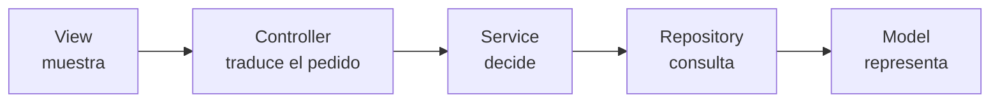

# Educarama — Fundamentos y decisiones de diseño

**Versión 2.1** (rama `refactor/v2.1`). Suma la decisión 2.9, el Composition Root con inyección de dependencias, y ajusta la 2.4 y la 2.6.

Este documento explica **por qué** Educarama está hecho como está. Cada decisión sigue el mismo esquema:

- **Problema:** qué había que resolver.
- **Decisión:** qué se hizo.
- **Alternativas descartadas:** qué otras opciones había y por qué no se eligieron.
- **Concepto:** el principio o patrón de diseño en el que se apoya, si lo hay.

El *cómo* (carpetas, clases, flujo de pedidos) está en [descripcion-tecnica.md](descripcion-tecnica.md).

---

## Parte 1 — El punto de partida

### 1.1 Rehacer el proyecto en lugar de emparcharlo

**Problema.** La primera versión (hoy en `_legacy/`) funcionaba en partes, pero tenía errores de fondo:
- Rutas de `require_once` rotas.
- Links con `/Educarama/` escritos a mano.
- Consultas a tablas que no existían (`protagonista_accion`).
- Servicios construidos con argumentos que no recibían.
- La rama de un protagonista deducida buscando texto en el nombre de la sección.
- Sin protección CSRF.

Además, la palabra `rama` significaba dos cosas distintas según el archivo.

**Decisión.** Una rama de git aparte (`refactor/v2`) que rehace el sistema **de adentro hacia afuera**, en este orden: base de datos → Models → Repositories → Services → Controllers → Views. El código viejo se consulta para portar funcionalidad, pero nunca se edita ni se incluye.

**Alternativas descartadas.**
- *Corregir el legacy archivo por archivo:* los problemas eran de estructura, no de líneas sueltas. Cada arreglo dependía de otros.
- *Empezar por las pantallas:* las pantallas dependen de todo lo demás. Construir primero la base garantiza que cada capa nueva se apoye en algo ya probado.

**Concepto.** Desarrollo *bottom-up* por capas: cada capa se termina y se prueba antes de construir la siguiente sobre ella.

### 1.2 Sin frameworks, sin Composer, sin npm

**Problema.** El equipo trabaja en XAMPP, en máquinas distintas y con niveles de experiencia distintos. Es un proyecto académico donde importa entender cada pieza.

**Decisión.** PHP, MySQL, HTML, CSS y JavaScript puros, con Bootstrap y SweetAlert2 por CDN con versión fija. El autoload de clases es propio, unas 30 líneas con `spl_autoload_register`.

**Alternativas descartadas.**
- *Laravel o Symfony:* resuelven mucho, pero esconden justamente lo que se quiere aprender (rutas, capas, seguridad) y suman una curva de aprendizaje y una instalación para cada integrante.
- *Composer solo para el autoload:* habría generado lo mismo que las 30 líneas propias, pero obligaba a todos a instalarlo. Como el autoload sigue la misma regla (PSR-4), se puede sumar Composer más adelante sin reescribir nada.

**Concepto.** **YAGNI** (*You Aren't Gonna Need It*): no sumar herramientas antes de necesitarlas. La convención **PSR-4** (namespace = carpeta, clase = archivo) mantiene la puerta abierta.

---

## Parte 2 — Arquitectura

### 2.1 Arquitectura en capas

**Problema.** En el legacy, una misma página podía consultar la base, decidir permisos, procesar el formulario e imprimir HTML. Así no se puede reutilizar una regla ni encontrar dónde vive.

**Decisión.** Cinco capas con responsabilidades separadas:

Cada capa conoce solo a la de abajo. Una regla de negocio, por ejemplo "solo un Responsable confirma una etapa", vive en **un único lugar**, el Service, y vale igual para cualquier pantalla o pedido que la use.

**Alternativas descartadas.**
- *MVC "clásico" con modelos activos (Active Record), donde el Model se guarda a sí mismo:* mezcla datos, SQL y reglas en la misma clase. Con más de 30 tablas y reglas que cruzan varias (permisos, cupos, herencias), eso se vuelve difícil de seguir.
- *Dos capas (páginas + funciones de base de datos):* es lo que tenía el legacy, y producía la duplicación y los errores mencionados.

**Concepto.** **Separación de responsabilidades** y **principio de responsabilidad única** (la S de SOLID). Los patrones concretos son **Repository** y **Service Layer**.

### 2.2 Models simples y un único punto de conversión

**Problema.** La base devuelve todo como texto o números: un `TINYINT` es 0/1, un `ENUM` es un string, un JSON es texto. Convertir esos valores en cada lugar que los usa genera errores sutiles.

**Decisión.** Cada Model es una clase `final` con propiedades públicas tipadas y un único método `desdeFila()` que hace **todas** las conversiones (TINYINT → `bool`, JSON → `array`, ENUM → enum de PHP). Los Models no tienen SQL ni reglas. Las listas cerradas (estado de progresión, nivel de rol, elemento, prioridad) son enums de PHP con su `etiqueta()`.

**Por qué.** Con `strict_types` y tipos en todas las propiedades, un dato mal convertido falla en el momento y en un lugar conocido, en lugar de propagarse. Los enums impiden que exista un estado `"desarollada"` mal escrito.

**Concepto.** **Objetos de datos** (cercanos a *Data Transfer Objects*) y **tipado fuerte**.

### 2.3 Repositories que siempre devuelven objetos

**Problema.** Si un repositorio devuelve arrays asociativos, cada consumidor tiene que conocer los nombres de las columnas, y un error de tipeo (`$fila['id_secion']`) no da error: da `null`.

**Decisión.** Los Repositories **siempre** devuelven Models (o listas de Models). Cuando una pantalla necesita una consulta con JOIN, por ejemplo la nómina con sección, patrulla y etapa, se crea una **clase vista** aparte (`ProtagonistaEnNomina`, `FichaProtagonista`) en lugar de agregarle campos extra a un Model.

**Alternativas descartadas.** *Agregar al Model `Protagonista` propiedades como `$nombreSeccion`:* el Model dejaría de representar una tabla, y esas propiedades valdrían `null` en la mitad de los casos.

**Concepto.** Patrón **Repository**: aísla el acceso a datos detrás de una interfaz que habla en objetos del dominio. Las clases vista son **modelos de lectura**: una forma de dato pensada para una pantalla concreta.

### 2.4 Services: el único lugar de las reglas y los permisos

**Problema.** Las reglas del programa scout son muchas y se cruzan: cupos, acciones requeridas según la rama, herencia de roles, elemento obligatorio en Caminantes…

**Decisión.**
- Los Services concentran **todas** las reglas.
- Reciben el id del usuario como parámetro (no leen la sesión) y devuelven objetos o lanzan una **excepción tipada**.
- Los permisos se calculan en un solo servicio, `PermisoService`, que todos los demás usan.
- Las operaciones que tocan varias tablas van dentro de una **transacción**: o se guarda todo o no se guarda nada.

**Por qué recibir el usuario como parámetro.** Un Service que lee `$_SESSION` solo funciona dentro de un navegador. Si recibe el id, se puede probar desde la línea de comandos, y queda explícito quién hace cada operación. La única excepción es `UsuarioService`, cuyo trabajo justamente es manejar la sesión.

**Por qué inyectar los repositorios.** Cada Service recibe sus repositorios y la conexión en el constructor. En una prueba se pueden reemplazar por otros sin tocar el Service. En la v2 eran parámetros opcionales con los reales por defecto; en la v2.1 son obligatorios y los arma el Composition Root (decisión 2.9).

**Concepto.** **Service Layer**, **inyección de dependencias** (sencilla, sin contenedor) y **atomicidad** de las transacciones (la A de ACID).

### 2.5 Excepciones tipadas en lugar de códigos de error

**Problema.** El Service tiene que comunicar resultados de naturaleza muy distinta: "no existe", "no tenés permiso", "dato inválido", "faltan requisitos pero podés seguir".

**Decisión.** Una jerarquía de excepciones (`NoEncontradoException`, `AccesoDenegadoException`, `ReglaNegocioException`, `RequisitosPendientesException`…), todas hijas de `ServicioException`. Un único traductor, `Respuesta::desdeExcepcion()`, las convierte en códigos HTTP (404, 403, 422, 409).

**Por qué.**
- El Service no sabe nada de HTTP.
- El Controller no tiene que repetir `if` para cada caso.
- Un error nuevo se agrega en un solo lugar.

Además, **solo los mensajes de `ServicioException` llegan al usuario**. Cualquier otro error (de SQL, de tipos) puede contener rutas o consultas, así que va al log y el usuario ve un mensaje genérico.

**Concepto.** **Manejo centralizado de errores** y **no filtrar información interna** (una práctica de OWASP).

### 2.6 Controllers delgados que no tocan el mundo exterior

**Problema.** Un controller que lee `$_POST` y llama a `header()` no se puede probar sin un servidor web.

**Decisión.**
- El Controller recibe arrays (`$get`, `$post`, `$files`) y devuelve un objeto `Respuesta` (página, JSON, redirección o archivo).
- Lee los datos con métodos que validan el tipo (`texto()`, `entero()`, `booleano()`).
- No aplica reglas de negocio.
- Quien "emite" la respuesta (manda headers e imprime) es `Respuesta::emitir()`, llamada por `Pagina` o `Api`.
- Recibe el `UsuarioService` y sus Services por constructor; desde la v2.1 no crea ninguno.

**Por qué.** Separar **decidir** qué responder de **enviar** la respuesta permite probar cada Controller por CLI y deja los efectos secundarios en un solo lugar.

**Concepto.** **Controllers delgados** y separación entre lógica y entrada/salida (*I/O*).

### 2.7 Dos puertas de entrada: páginas para ver, API para guardar

**Problema.** En el legacy, cada formulario apuntaba a un archivo PHP distinto que procesaba y redirigía, con validaciones y protecciones repetidas (o ausentes).

**Decisión.**
- **Páginas** (`views/pages/*.php`): solo GET, solo muestran.
- **Todo lo que modifica** va por `fetch` a un único `public/api.php`, que tiene una **lista fija** de 36 acciones con su método HTTP y su Controller. `Api` valida acción, método, tamaño y token CSRF **antes** de llamar a cualquier Controller.
- La respuesta es siempre JSON con el mismo formato.

**Alternativas descartadas.**
- *Un archivo por acción:* cada uno tendría que repetir la validación de CSRF y el manejo de errores, y bastaría con olvidarla en uno.
- *Un enrutador dinámico (`?accion=Clase.metodo` resuelto por nombre):* permitiría llamar a cualquier método público armando la URL. La lista fija es una **lista blanca**: lo que no está, no existe.

**Concepto.** Patrón **Front Controller**, **lista blanca** (*allowlist*) y separación **lectura/escritura** (GET seguro e idempotente; POST para cambiar estado, como indica HTTP).

### 2.8 Componente de archivos genérico y separado

**Problema.** Subir archivos tiene riesgos técnicos (tipo falso, nombres peligrosos, acceso directo) que no dependen del proyecto. Las reglas de *quién* puede ver *qué* documento, en cambio, son de Educarama.

**Decisión.** Dos capas:
1. `src/Almacen/` sabe guardar, enviar y borrar archivos de forma segura y **no depende de ninguna otra clase del proyecto**:
   - Comprueba el tipo real con `finfo`, no con la extensión.
   - Guarda con nombre aleatorio.
   - Envía con `nosniff` y `no-store`.
2. `DocumentoService` decide permisos, pertenencia y carpeta.

Los archivos viven en `storage/`, bloqueado por `.htaccess`. La descarga pasa siempre por un Controller que pregunta al Service.

**Por qué este orden de operaciones.**
- Al subir, primero el archivo y después la fila: si la fila falla, se borra el archivo y no queda una fila apuntando a la nada.
- Al eliminar, primero la fila y después el archivo: si el borrado del archivo falla, queda un archivo huérfano, que es inofensivo y mejor que una fila rota.

**Concepto.** **Bajo acoplamiento** y **alta cohesión**: el componente es reutilizable porque no sabe nada del dominio. **Defensa en profundidad**: varias barreras independientes.

### 2.9 Composition Root: un solo lugar arma todos los objetos (v2.1)

**Problema.** En la v2, cada clase podía crear sus propias dependencias: `$this->patrullas = $patrullas ?? new PatrullaRepository();`. Funcionaba, pero tenía costos:
- **Dependencias ocultas.** Para saber de qué dependía una clase había que leer su constructor completo, y cualquiera podía hacer `new` de cualquier cosa desde cualquier lugar.
- **Instancias repetidas.** `ProtagonistaService` creaba su propio `PermisoService`, que creaba sus propios repositorios. En un mismo pedido convivían varias copias de lo mismo.
- **La conexión, implícita.** Cada repositorio buscaba la conexión por su cuenta (`Database::getConexion()`), y que todos compartieran la misma transacción dependía de ese *singleton* escondido.

**Decisión.**
- Todas las dependencias pasan a ser **parámetros obligatorios del constructor**. Ninguna clase hace `new` de sus colaboradores.
- Un archivo, **`src/main.php`**, es el *Composition Root*: registra en un contenedor cómo se crea cada clase (55 en total) y lo devuelve. Está inspirado en el `Program.cs` de .NET.
- El **`Contenedor`** (`src/Contenedor.php`, unas 35 líneas) guarda las fábricas y entrega **una sola instancia por clase** durante el pedido.
- Las puertas de entrada (`views/pages/*.php`, `public/api.php`, `public/descargar.php`) son los únicos lugares que le piden objetos al contenedor (`$app->obtener(XController::class)`).

**Alternativas descartadas.**
- *Seguir con `?? new` (lo de la v2):* cómodo, pero con los costos de arriba.
- *Una librería de inyección (PHP-DI, Symfony DI):* resuelven sola la mayoría de los registros (*autowiring*), pero exigen Composer, y el stack del proyecto excluye herramientas externas.
- *Autowiring propio por reflexión:* menos líneas en `main.php`, pero "mágico" y más difícil de seguir. Un registro escrito a mano se lee de arriba abajo y muestra todo el grafo de dependencias.
- *Pasarle el contenedor a cada clase para que pida lo que quiera:* es el antipatrón *Service Locator*; volvería a esconder las dependencias. Por eso el contenedor solo se usa en las puertas de entrada.

**Por qué.**
- Las dependencias de cada clase están **a la vista en su constructor**.
- Hay **una sola conexión y una sola instancia** de cada Service por pedido, y es explícito: las transacciones abarcan a todos los repositorios porque reciben el mismo objeto PDO.
- Cambiar una implementación (por ejemplo, un repositorio falso para una prueba) es cambiar **una línea** en `main.php` o pasar otro objeto al constructor.
- **Costo aceptado:** cada clase nueva hay que registrarla en `main.php`; si se olvida, el contenedor avisa con "Dependencia no registrada".

**Concepto.** **Inyección de dependencias** por constructor, **Inversión de Control** (IoC: la clase no decide qué recibe), patrón **Composition Root** y **contenedor de IoC**. Es la **D de SOLID** (*Dependency Inversion*): las clases dependen de lo que reciben, no de cómo se crea.

---

## Parte 3 — Modelo de datos

### 3.1 Rama ≠ Sección

**Problema.** En el legacy, `rama` era a veces "Scouts" (la categoría) y a veces "la Unidad del grupo 64" (una instancia concreta). Una misma columna `id_rama` apuntaba a cosas distintas según el archivo.

**Decisión.** Dos tablas distintas:
- **`rama`**: la categoría del programa. Es estática y tiene 4 filas.
- **`seccion`**: la rama dentro de un grupo concreto. Es dinámica y tiene `id_grupo` e `id_rama`.

Todo lo que depende del programa (competencias, etapas, colores, si usa acciones) se resuelve **por id de rama**, nunca por el nombre de la sección.

**Por qué.** Es la distinción entre **tipo** e **instancia**. Que una sección se llame "Manada Luna Llena" no tiene por qué decir nada de su rama. El legacy deducía la rama buscando la palabra "Manada" en el nombre, y eso fallaba con cualquier nombre creativo.

**Concepto.** **Normalización** y modelado **tipo/instancia** (en catálogos de software se lo suele llamar *Type Object*).

### 3.2 Tablas estáticas: el programa scout como dato

**Problema.** Las ramas, áreas, competencias, acciones, etapas e insignias son las del programa oficial y casi no cambian. Pero cada rama usa palabras distintas para lo mismo: las áreas son "Senderos" en LyL y "Áreas de crecimiento" en Rovers, y el pequeño equipo es "Seisena", "Patrulla" o "Equipo".

**Decisión.**
- Esos datos son **tablas estáticas** que solo modifican los desarrolladores. Sus Repositories son de solo lectura.
- Las diferencias entre ramas son **datos** y no `if` en el código: `rama.usa_especialidades`, `rama.usa_acciones`, `etapa.competencias_etapa`, y la tabla `nomenclatura` con los términos de cada rama.

**Por qué.** Si mañana cambia el cupo de una etapa o el nombre de un área, se actualiza una fila, no el código. El código pregunta "¿esta rama usa acciones?" en lugar de "¿esta rama es la 4?".

**Concepto.** **Diseño guiado por datos** (*data-driven*) y separación entre catálogo y operación.

### 3.3 La persona como entidad compartida

**Problema.** Un familiar puede ser protagonista de otra sección (un hermano Rover), y dos protagonistas hermanos comparten padres. Duplicar los datos haría que, al corregir un teléfono, quede mal en otra ficha.

**Decisión.**
- `persona` guarda lo común, con **DNI único**.
- `protagonista` y `familiar` se apoyan en ella.
- `es_familia` es la relación N:N entre protagonistas y familiares.
- Al cargar un DNI que ya existe, se avisa (mostrando solo el nombre) y se crea solo el vínculo.

**Concepto.** **Generalización/especialización** en el modelo entidad-relación y **evitar redundancia** (normalización).

### 3.4 Progresión: "sin fila = pendiente" y nada derivado guardado

**Problema.** Un protagonista tiene decenas de competencias y cientos de acciones posibles. Guardar una fila por cada combinación al darlo de alta sería costoso y habría que mantenerlo sincronizado con el catálogo.

**Decisión.**
- **Sin fila = pendiente.** Elegir una competencia crea la fila; avanzar es un `UPDATE`; volver a Pendiente la borra.
- Lo que se puede **calcular** no se guarda: la etapa actual (la última lograda), la etapa en curso (la siguiente), lo adeudado para confirmar una etapa y la insignia pendiente se calculan en vivo.

**Por qué.** Un dato derivado guardado puede quedar desactualizado (por ejemplo, si se quita una etapa lograda). Calcularlo siempre garantiza que la pantalla dice la verdad. El volumen del proyecto (cientos de protagonistas por grupo, no millones) hace que el cálculo sea instantáneo.

**Concepto.** **Fuente única de verdad** (*single source of truth*) y **evitar desnormalización prematura**.

### 3.5 Claves primarias propias y compuestas

**Decisión.**
- Las entidades tienen `id` autoincremental propio.
- Las tablas de relación y de progresión usan **clave compuesta** (`id_protagonista` + `id_competencia`).

**Por qué.** La clave compuesta impide por diseño que una misma competencia figure dos veces para el mismo protagonista: la base lo garantiza aunque el código tenga un error. Las claves foráneas con `ON DELETE CASCADE` hacen que eliminar un protagonista limpie su progresión, documentos y vínculos sin código extra.

**Concepto.** **Integridad referencial** e **integridad de entidad**.

---

## Parte 4 — Reglas de negocio

### 4.1 Avisar en lugar de bloquear

**Problema.** El programa scout define requisitos (acciones, tareas, cupos), pero la progresión es un proceso **educativo**, no un trámite. El educador conoce al protagonista y puede tener buenas razones para reconocer un logro aunque falte algo en el registro.

**Decisión.**
- Casi todas las reglas **avisan y dejan seguir**: el sistema muestra lo adeudado y pregunta "¿confirmar igual?". Técnicamente es el código 409 y la repetición del pedido con `confirmarIgual=1`.
- Solo bloquea lo que rompería la coherencia del registro, por ejemplo confirmar una etapa sin haber logrado la anterior.
- **Nada se confirma automáticamente**: aunque se cumplan todos los requisitos, un educador con rol Responsable o superior tiene que confirmar.

**Alternativas descartadas.**
- *Bloquear siempre:* el sistema le diría al educador que no puede hacer algo que el método scout sí le permite, y terminarían usando una planilla aparte.
- *Confirmar automáticamente al cumplir los requisitos:* el reconocimiento de un logro es un acto educativo y humano (muchas veces con una ceremonia), no un cálculo.

**Concepto.** **El sistema asiste, la persona decide** (*human in the loop*). En diseño de interfaces: **prevención de errores con confirmación** en lugar de restricción.

### 4.2 Cupo fijo de competencias por etapa

**Problema.** El programa de LyL habla de "16 a 20 competencias por etapa", pero con 47 competencias en total y 4 etapas eso es imposible de cumplir. Hacía falta una regla aplicable a todas las ramas.

**Decisión.** Cada etapa tiene un **cupo fijo**: el total de competencias de la rama dividido por la cantidad de etapas, redondeado, y la última etapa se lleva el resto. Por ejemplo, LyL tiene 47 competencias, que quedan en 12 + 12 + 12 + 11. El cupo es un dato estático (`etapa.competencias_etapa`) y se evalúa con avisos salteables.

**Por qué.** Es simple de entender para el educador ("te faltan 3 de 12"), se aplica igual a las cuatro ramas y, al recorrer todas las etapas, garantiza que el protagonista desarrolle todas las competencias. Al ser un dato, se puede ajustar sin tocar el código.

### 4.3 Insignias separadas de las etapas

**Problema.** Parecería natural que confirmar una etapa otorgue su insignia. Pero según el programa, la insignia de una etapa se entrega **cuando la etapa empieza**, no cuando termina, y la entrega física ocurre en otro momento.

**Decisión.** Las insignias se registran **aparte y a mano**, con la fecha real de la entrega. El sistema solo **avisa** cuando una etapa está en curso y el protagonista todavía no recibió su insignia.

**Por qué.** El registro refleja lo que pasó en la realidad (quién la entregó y cuándo), no lo que el sistema supuso.

### 4.4 Fechas reales, nunca futuras

**Decisión.**
- Confirmar una etapa y otorgar una insignia aceptan la fecha de la ceremonia o de la entrega (por defecto hoy, nunca futura).
- El resto de las operaciones usa siempre la fecha de hoy.
- "Hoy" se calcula con una zona horaria fija (`ZONA_HORARIA`).

**Por qué.** Las ceremonias se cargan después de que ocurren. Una fecha futura sería un registro de algo que todavía no pasó. Fijar la zona horaria evita que un servidor en otra región cambie el día.

---

## Parte 5 — Roles, permisos y privacidad

### 5.1 Cuatro niveles acumulativos

**Problema.** En un grupo scout participan adultos con responsabilidades muy distintas: quien coordina la sección, quien ayuda, quien supervisa desde el distrito.

**Decisión.** Cuatro niveles ordenados: **Supervisor (1) < Ayudante (2) < Responsable (3) < Jefe (4)**. Cada uno incluye los permisos de los anteriores. Así, "¿puede hacer X?" se resuelve con una comparación: `nivel >= mínimo`.

**Alternativas descartadas.** *Permisos sueltos por acción ("puede subir documentos", "puede confirmar etapas"…):* más flexible, pero mucho más difícil de gestionar para un Jefe de grupo y de explicar. Los cuatro niveles cubren los casos reales del grupo scout.

**Concepto.** **Control de acceso basado en roles** (RBAC, *Role-Based Access Control*) con **roles jerárquicos**.

### 5.2 Herencia limitada: solo el Jefe de grupo

**Problema.** Si todos los roles de grupo se heredaran a las secciones, un Supervisor de grupo vería los datos personales de todos los protagonistas, que es justamente lo que su rol no debe ver.

**Decisión.**
- **Solo el Jefe de grupo** hereda el rol Jefe en todas las secciones de su grupo, calculado en código y sin filas en `acceso_seccion`.
- Los demás roles de grupo valen solo para las pantallas del grupo.
- Para entrar a una sección hace falta un acceso explícito a esa sección.

**Por qué calculado y no copiado.** Si al nombrar un Jefe de grupo se copiaran filas en cada sección, al crear una sección nueva o al quitarle el rol habría que acordarse de actualizarlas. Calcularlo en el momento evita esa inconsistencia.

**Concepto.** **Principio de mínimo privilegio**: cada usuario accede a lo mínimo necesario para su función.

### 5.3 404 en lugar de 403 cuando no hay acceso

**Problema.** Si un usuario de otro grupo prueba `perfil_protagonista.php?id=25` y recibe "acceso denegado", ya sabe que el protagonista 25 existe. Probando números, podría saber cuántos hay.

**Decisión.**
- **Sin ningún acceso** a la sección o al grupo del dato: **404**, como si no existiera.
- **Con acceso pero sin el rol suficiente**: **403**. En ese caso no se revela nada nuevo, porque ya puede ver la sección.

**Concepto.** **No revelar la existencia de recursos** (prevención de enumeración, recomendada por OWASP).

### 5.4 El administrador no es un superusuario

**Problema.** Alguien tiene que aprobar los grupos nuevos. Pero que esa persona pueda ver los datos de todos los chicos de todos los grupos sería un riesgo innecesario.

**Decisión.** El administrador (`usuario.es_admin`) **solo** aprueba o rechaza solicitudes de alta. Si necesita entrar a un grupo, se le da un acceso como a cualquier otro usuario.

**Concepto.** **Mínimo privilegio** y **separación de funciones**. Se trata de datos de menores, y en Argentina rige la Ley 25.326 de Protección de Datos Personales.

### 5.5 Alta de grupos por solicitud revisada

**Decisión.** El usuario se registra sin accesos y envía una solicitud con el código y el nombre del grupo y sus secciones. Un administrador la aprueba (se crean el grupo y las secciones y el solicitante queda como Jefe de grupo) o la rechaza con un motivo que el solicitante ve. Los datos se validan al enviar y otra vez al aprobar, porque entre una cosa y otra otro grupo pudo haber usado el mismo código.

**Por qué.** Evita grupos falsos o duplicados sin depender todavía de la validación oficial (Cruz del Sur, prevista para más adelante). Revalidar al aprobar evita una **condición de carrera** entre dos solicitudes.

---

## Parte 6 — Seguridad

Cada medida responde a un riesgo conocido de las aplicaciones web (OWASP Top 10).

| Riesgo | Medida | Por qué así |
|---|---|---|
| **Inyección SQL** | Consultas preparadas de PDO **sin emulación** | Con la emulación desactivada, la consulta y los datos viajan por separado hasta MySQL: un dato nunca se interpreta como SQL. |
| **XSS** | Todo dato impreso pasa por `e()` | Escapar **al imprimir** (no al guardar) protege cualquier dato, venga de donde venga, y no altera lo guardado. |
| **CSRF** | Token por sesión en cada POST, validado por `Api` antes del Controller | Un sitio ajeno puede hacer que el navegador envíe un pedido, pero no puede leer el token. Validarlo en un único lugar evita olvidos. |
| **Robo o fijación de sesión** | Cookie `httponly` y `SameSite=Lax`, `use_strict_mode`, regenerar el id al loguearse | JavaScript no puede leer la cookie, no se aceptan ids inventados y un id previo al login deja de servir. |
| **Contraseñas** | `password_hash()` con el algoritmo por defecto de PHP | Hash lento con *salt* incluido. El algoritmo se actualiza solo con nuevas versiones de PHP. |
| **Enumeración de cuentas** | Mensaje único "Email o contraseña incorrectos." | No revela si un email está registrado. |
| **Redirección abierta** | `volver` solo acepta rutas `views/pages/*.php` | Impide usar el login para mandar al usuario a un sitio malicioso. |
| **Archivos maliciosos** | Tipo real con `finfo`, nombre aleatorio, `storage/` bloqueado, descarga controlada | Un `.php` renombrado a `.pdf` no pasa, y aunque pasara, no se puede ejecutar ni pedir directamente. |
| **Fuga de información** | Solo los mensajes del Service llegan al usuario | Rutas del disco, SQL y trazas quedan en el log del servidor. |

**Concepto general.** **Defensa en profundidad**: ninguna medida depende de que otra funcione. Y **seguro por defecto**: la estructura (la API con su lista, `e()`, `Csrf::campo()`) hace que lo seguro sea lo más fácil de escribir.

---

## Parte 7 — Interfaz

### 7.1 Guardado inmediato en la pantalla de competencias

**Problema.** Un educador marca competencias y acciones de a muchas, a veces desde el celular en una actividad al aire libre. Un botón "Guardar todo" al final arriesga perder el trabajo si se corta la conexión o se cierra la página.

**Decisión.** Cada clic se guarda en el momento con un `fetch`, de a una operación por vez. La respuesta trae el resumen actualizado (contadores, adeudado, insignia pendiente) y la pantalla se repinta sin recargar.

**Por qué.** Cada operación es chica y atómica, y si falla, falla solo esa. Las reglas y avisos de cada paso (cupo, acciones) se pueden mostrar justo cuando corresponden, y no todos juntos al final.

### 7.2 Un JavaScript común y declarativo

**Decisión.** `educarama.js` conecta cualquier botón o formulario que declare atributos `data-accion`, `data-confirmar`, `data-recargar`, etc. Ese archivo resuelve el token, el flujo del 409, los errores y las redirecciones. Solo las pantallas complejas tienen su propio archivo.

**Por qué.** El comportamiento de los pedidos es uno solo y está en un solo lugar. Agregar un botón nuevo es escribir HTML, no JavaScript.

**Concepto.** **No te repitas** (DRY) y **mejora progresiva**: sin SweetAlert2, por ejemplo sin internet, se usan los cuadros nativos del navegador.

### 7.3 Imagen de marca: colores como variables y marcas oficiales como dato

**Problema.** El legacy tenía colores escritos a mano por todos lados, texto amarillo sobre blanco ilegible y la rama deducida por el nombre.

**Decisión.**
- Todos los colores salen de variables CSS en `:root` y de una clase por rama, elegida **por id de rama**.
- Se respetan contrastes mínimos de accesibilidad (4,5:1 para texto, según WCAG).
- Los logos e insignias oficiales de Scouts de Argentina se usan solo para representar **datos** (la rama de una sección, la insignia de un protagonista), nunca como identidad de la aplicación, y sin alterarlos.
- El pie aclara que es un proyecto académico sin vinculación oficial.

**Por qué.**
- Un color definido una vez se cambia una vez.
- El contraste es una cuestión de accesibilidad, no de gusto.
- Usar una marca ajena como propia implicaría una afiliación que no existe.

---

## Parte 8 — Lo que se dejó para después, a propósito

No todo lo deseable entró en esta versión, y eso también fue una decisión:

| Pendiente | Por qué todavía no |
|---|---|
| Validación con Cruz del Sur | Depende de un sistema externo; hoy la reemplaza la revisión del administrador. |
| Emails (avisos, recuperación de contraseña, invitaciones) | Requiere un servidor de correo configurado; la estructura ya lo prevé (`token_recuperacion`, `notificarRechazo`). |
| Contraseña mínima de 8 caracteres | Lista en el código (versión A); hoy está activa la de 6 para agilizar las pruebas. |
| Bloqueo por intentos fallidos de login | Se suma junto con la recuperación de contraseña. |
| Baja lógica con respaldo | Hoy eliminar es definitivo (solo el Jefe puede hacerlo). |
| Auditoría de confirmaciones | Registrar quién confirmó cada logro; no es necesario para el funcionamiento básico. |

**Concepto.** **Alcance incremental**: primero un núcleo completo y coherente, después las extensiones. Varias ya tienen su lugar reservado en el esquema, así que agregarlas no obliga a rediseñar.

---

## Resumen: las ideas centrales

1. **Rehacer por capas, de la base hacia la pantalla**, en lugar de emparchar.
2. **Cada capa tiene un trabajo**: Model representa, Repository consulta, Service decide, Controller traduce, View muestra.
3. **Las reglas y los permisos viven en un solo lugar**: los Services.
4. **Rama (tipo) y Sección (instancia) son cosas distintas**, y todo se resuelve por id.
5. **El programa scout es dato**, no código: cupos, términos y diferencias entre ramas están en tablas.
6. **Lo calculable no se guarda**: la etapa en curso y lo adeudado se calculan en vivo.
7. **El sistema avisa, el educador decide**: casi nada bloquea y nada se confirma solo.
8. **Mínimo privilegio**: cuatro roles acumulativos, herencia solo del Jefe de grupo, admin sin acceso a datos y 404 para lo ajeno.
9. **Seguro por defecto**: una sola puerta para escribir (API con lista blanca y CSRF), consultas preparadas, escape de salida y archivos fuera del alcance del navegador.
10. **Sin dependencias innecesarias**: PHP y MySQL puros sobre XAMPP, entendibles y fáciles de instalar para todo el equipo.
11. **Un solo lugar arma todo** (v2.1): las clases piden sus dependencias en el constructor y `src/main.php` las crea una vez por pedido.
